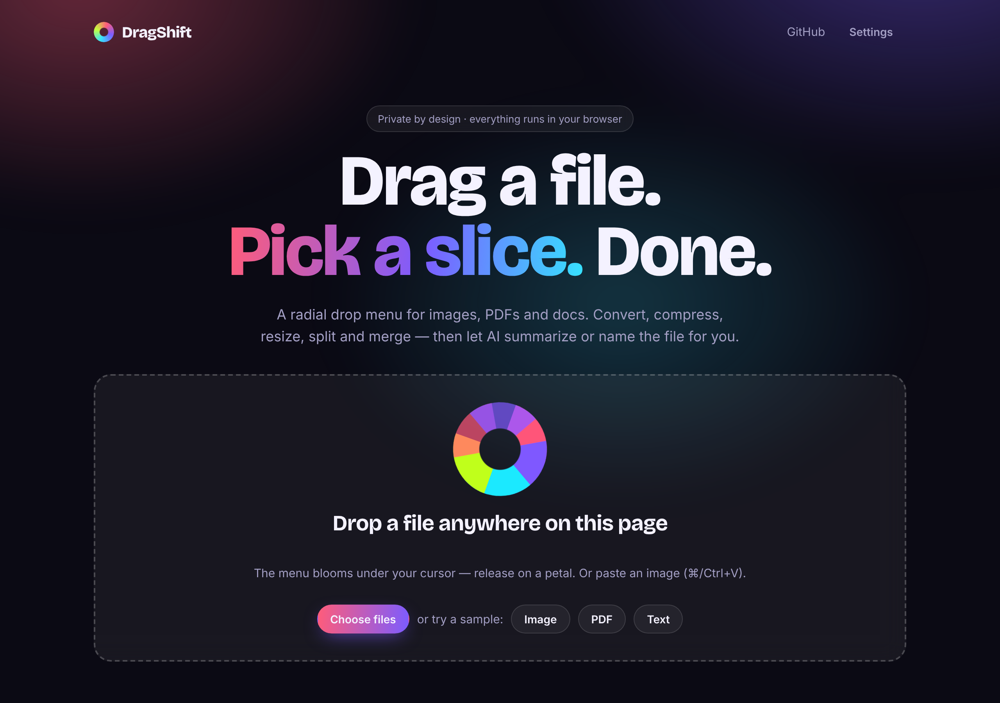
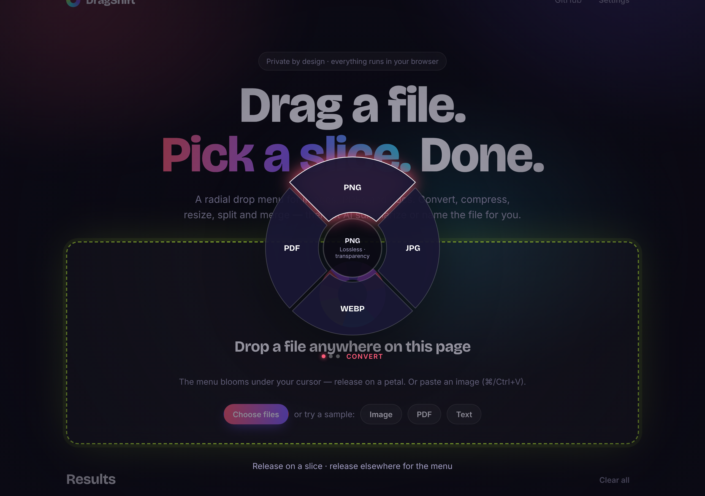
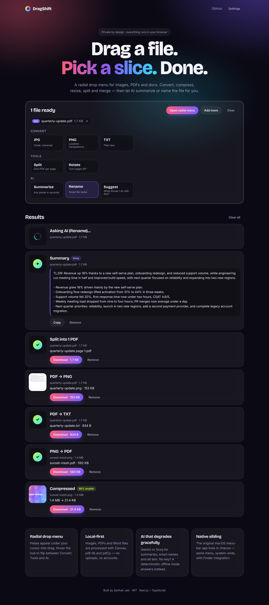
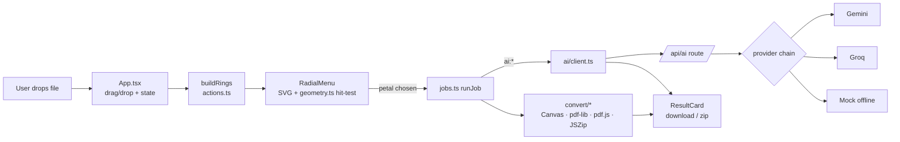

# DragShift

**Drag a file, pick a slice, done.** A radial drop menu that converts, compresses, resizes, splits and merges images, PDFs and docs — entirely in your browser — with optional AI summaries, smart file names and alt text.



| Radial menu under your cursor | Results with before/after |
|---|---|
|  |  |

> Two apps live in this repo: the **web app** (this README, repo root) and the original **native macOS menu-bar app** in [`macos/`](macos/README.md), which brings the same menu to Finder drags system-wide.

## Features

- **Radial drop menu** — drag a file over the page and petals bloom under the cursor; release on one to run it. Hover the hub to flip between **Convert / Tools / AI**. Release elsewhere to get the same menu in click mode. Every action is also reachable from plain buttons (keyboard / touch friendly).
- **Convert** — images ⇄ PNG / JPG / WEBP, images → PDF (many images → one PDF), PDF → PNG / JPG / TXT, DOCX → PDF / TXT, text/markdown/CSV/JSON → PDF.
- **Tools** — compress (shows % saved), resize (percent / longest side / width / height), PDF split / rotate / merge.
- **AI** — summarize a document, suggest a file name (and download the renamed copy), write image alt text, or ask "what should I do with this?". Powered by Gemini or Groq; works offline in **mock mode** with no key.
- **Private by design** — files never leave the browser; only extracted text (or a small downscaled image) is sent to `/api/ai` when you explicitly use an AI action.
- Samples, paste-from-clipboard, per-job progress / error states, download-all as ZIP, quality & DPI settings.

## Tech stack

Next.js 15 (App Router) · React 19 · TypeScript (strict) · pdf-lib · pdf.js · JSZip · Canvas API · Vitest · ESLint. Hand-written CSS, no UI kit.

## Architecture



## Getting started

```bash
npm install
cp .env.example .env.local   # optional – leave keys empty for mock AI
npm run dev                  # http://localhost:3000
```

Other scripts: `npm test`, `npm run lint`, `npm run typecheck`, `npm run build`.
Full setup, env vars and deployment notes are in [developer.md](developer.md); a feature-by-feature walkthrough is in [CHANGES.md](CHANGES.md).

## Roadmap

- HEIC input, GIF/ICO output, crop & annotate, PDF compress/protect
- Web-worker pipeline for very large files; PWA/offline install
- Browser extension to open the menu on any ``

## License

MIT
